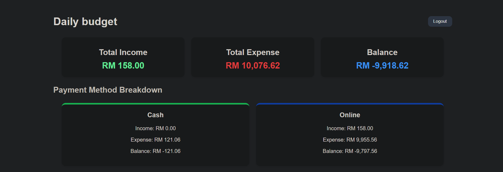
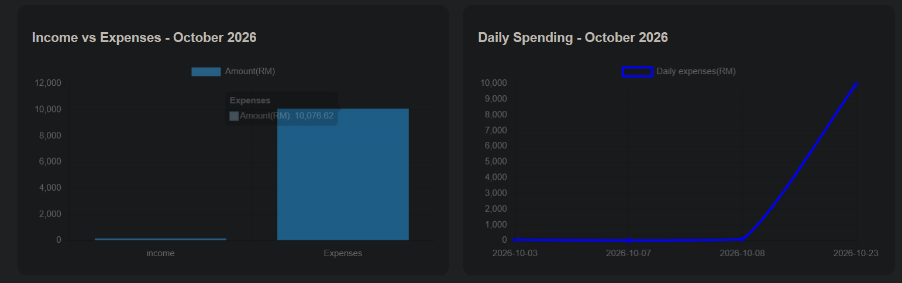
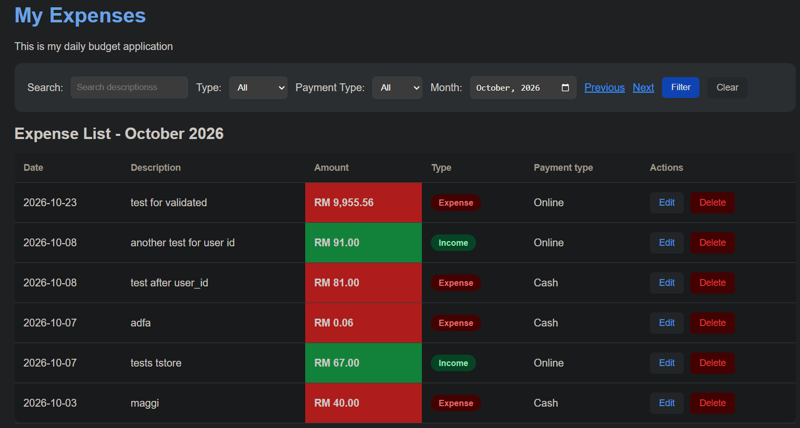
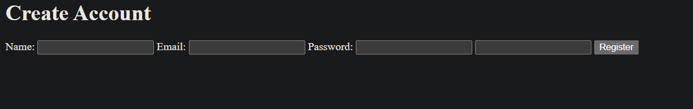
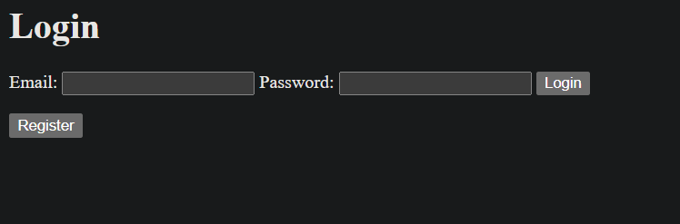

# Daily Budget - Personal Finance Web Application

A personal finance web application built using Laravel, PHP, MySQL, and JavaScript. Daily Budget helps users record income and expenses, monitor monthly spending, and visualize their financial activity through an interactive dashboard.

## Live Demo

**website**: https://daily-budget-production-uqcwxr.laravel.cloud

Daily budget is deployed on Laravel Cloud with a MySQL database hosted on Aiven.

## Try the Application

1. Visit the [Daily Budget Website](https://daily-budget-production-uqcwxr.laravel.cloud/).
2. Register a new account.
3. Add income and expense transactions.
4. Explore the dashboard, charts, monthly summaries, search and filters.

Each user has their own private transaction records.


## Features

- **User Authentication**: Register, log in and log out securely
- **Transaction Management**: Add, view, edit, and delete income and expense transactions.
- **Monthly Dashboard**: View total income, total expenses, balance, and transaction summaries.
- **Financial Charts**: Visualize monthly financial activity using Chart.js.
- **Search and Filtering**: Search transactions by description and filter by month, transaction type, and payment method.
- **Pagination**: Browse transaction records in manageable pages.
- **User-Specific Data**: Each user can access and manage only their own transactions.
- **Responsive Interface**: Dashboard layout designed to adapt to different screen sizes.

## Technologies Used

| Technology | Purpose |
|---|---|
| PHP | Backend programming |
| Laravel | Web framework |
| MySQL | Database |
| JavaScript | Frontend interactions |

## Getting Started

### Prerequisites

- PHP compatible with the project's Laravel version
- Composer
- MySQL
- Node.js and npm

### Installation

1. Clone the repository:
```
git clone https://github.com/AizatW/daily-budget.git
cd daily-budget
```

2. Install php dependancies
```
compose install
```

3. Create the environment configuration:
```
cp .env.example .env
```
On Windows PowerShell, use Copy-Item .env.example .env instead.

4. Generate an application key
```
php artisan key:generate
```

5. Create a MySQL database named daily_budget and configure the database connection in .env.

6. Run database migrations
```
php artisan migrate
```

7. Install and build frontend dependencies:
```
npm install
npm run build
```

8. Start the development server
```
php artisan serve
```

Open http://127.0.0.1:8000 in your browser.

### Testing

Run the automated tests using:
```
php artisan test
```

### Project Status

The core transaction management and financial dashboard features have been implemented.

Planned improvements include recurring income and commitment management, an installable Progressive Web App (PWA), and public deployment.

## Author

**Aizat Wafri**

GitHub: https://github.com/AizatW

## Screenshots

### Dashboard Overview



### Transaction Table


### Register and Login

